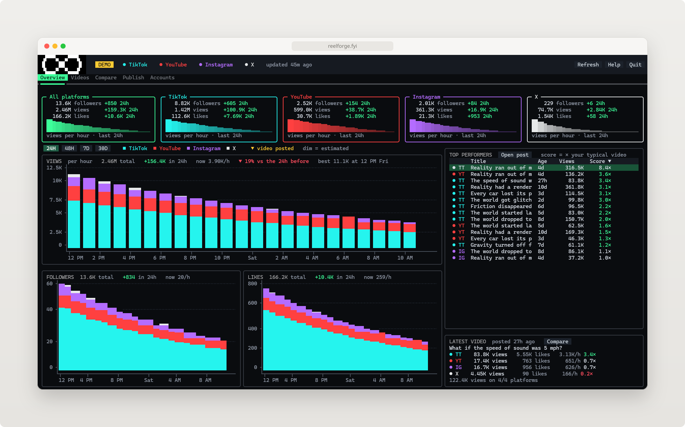

# Hi, I'm DJ

### Most of what I make starts as a fix for something that annoyed me: a dashboard for the short-form videos I post, and a stack of small Go tools for the everyday stuff that slows down coding.

  <a href="https://go.dev"><picture><source media="(prefers-color-scheme: dark)" srcset="https://skillicons.dev/icons?i=go&theme=dark"></picture></a>
  <a href="https://www.python.org"><picture><source media="(prefers-color-scheme: dark)" srcset="https://skillicons.dev/icons?i=python&theme=dark"></picture></a>
  <a href="https://developer.mozilla.org/en-US/docs/Web/JavaScript"><picture><source media="(prefers-color-scheme: dark)" srcset="https://skillicons.dev/icons?i=js&theme=dark"></picture></a>
  <a href="https://www.typescriptlang.org"><picture><source media="(prefers-color-scheme: dark)" srcset="https://skillicons.dev/icons?i=ts&theme=dark"></picture></a>
  
  <a href="https://dev.java"><picture><source media="(prefers-color-scheme: dark)" srcset="https://skillicons.dev/icons?i=java&theme=dark"></picture></a>
  <a href="https://isocpp.org"><picture><source media="(prefers-color-scheme: dark)" srcset="https://skillicons.dev/icons?i=cpp&theme=dark"></picture></a>
  <a href="https://learn.microsoft.com/dotnet/csharp/"><picture><source media="(prefers-color-scheme: dark)" srcset="https://skillicons.dev/icons?i=cs&theme=dark"></picture></a>
  <a href="https://www.rust-lang.org"><picture><source media="(prefers-color-scheme: dark)" srcset="https://skillicons.dev/icons?i=rust&theme=dark"></picture></a>
  <a href="https://en.cppreference.com/w/c"><picture><source media="(prefers-color-scheme: dark)" srcset="https://skillicons.dev/icons?i=c&theme=dark"></picture></a>
  <a href="https://www.swift.org"><picture><source media="(prefers-color-scheme: dark)" srcset="https://skillicons.dev/icons?i=swift&theme=dark"></picture></a>
  <a href="https://www.gnu.org/software/bash/"><picture><source media="(prefers-color-scheme: dark)" srcset="https://skillicons.dev/icons?i=bash&theme=dark"></picture></a>

## ReelForge

### ReelForge is a home base for a short-form video channel. It tracks followers, views and likes hour by hour on TikTok, YouTube, Instagram and X, and scores every video against your typical one so you can see what's working.

### Posting stays manual, just faster. Pick a finished video and ReelForge copies each platform's caption, shows you the file and opens the upload page. No API keys or developer accounts needed.

<a href="https://reelforge.fyi"><picture><source media="(prefers-color-scheme: dark)" srcset="assets/open-reelforge-dark.svg"></picture></a>
<a href="https://github.com/dan2756/ReelForge"><picture><source media="(prefers-color-scheme: dark)" srcset="assets/view-repository-dark.svg"></picture></a>

 

<a href="https://reelforge.fyi"><picture><source media="(prefers-color-scheme: dark)" srcset="assets/reelforge-dark.svg"></picture></a>

## Go tools

### [PortReaper](https://github.com/dan2756/PortReaper): see what's holding a port and stop it

### [BranchBroom](https://github.com/dan2756/BranchBroom): find merged and months-old Git branches and clear them out

### [FlakeRadar](https://github.com/dan2756/FlakeRadar): run a test over and over to see how flaky it really is

### [TodoFossil](https://github.com/dan2756/TodoFossil): list every TODO by how long it's been sitting in the code

### [JSONSilhouette](https://github.com/dan2756/JSONSilhouette): get the shape of unfamiliar JSON without scrolling through it

### The rest are in [my repositories](https://github.com/dan2756?tab=repositories).
