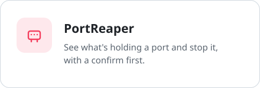
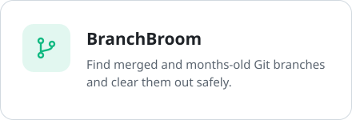
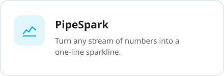
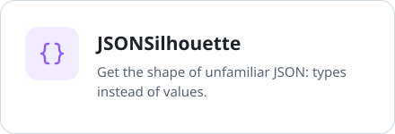
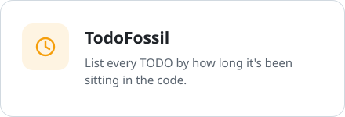
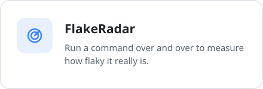

<picture>
  <source media="(prefers-color-scheme: dark)" srcset="assets/header-dark.svg">
  
</picture>

 

Most of what I make starts as a fix for something that annoyed me: a dashboard for the short-form videos I post, and a stack of small Go tools for the everyday stuff that slows down coding.

  <picture>
    <source media="(prefers-color-scheme: dark)" srcset="https://skillicons.dev/icons?i=go%2Cpython%2Cts%2Cjs%2Cswift%2Ccpp%2Cbash&theme=dark">
    
  </picture>

## ReelForge

One home for a channel that posts to TikTok, YouTube, Instagram and X. It tracks followers, views and likes hour by hour on every platform, scores each video against your typical one, puts the same video side by side across platforms, and gets uploads ready so posting by hand takes seconds. No API keys needed.

[See ReelForge →](https://github.com/dan2756/ReelForge)

## Go tools

  <a href="https://github.com/dan2756/PortReaper"><picture><source media="(prefers-color-scheme: dark)" srcset="assets/portreaper-dark.svg"></picture></a>
  <a href="https://github.com/dan2756/BranchBroom"><picture><source media="(prefers-color-scheme: dark)" srcset="assets/branchbroom-dark.svg"></picture></a>
  <a href="https://github.com/dan2756/PipeSpark"><picture><source media="(prefers-color-scheme: dark)" srcset="assets/pipespark-dark.svg"></picture></a>
  <a href="https://github.com/dan2756/JSONSilhouette"><picture><source media="(prefers-color-scheme: dark)" srcset="assets/jsonsilhouette-dark.svg"></picture></a>
  <a href="https://github.com/dan2756/TodoFossil"><picture><source media="(prefers-color-scheme: dark)" srcset="assets/todofossil-dark.svg"></picture></a>
  <a href="https://github.com/dan2756/FlakeRadar"><picture><source media="(prefers-color-scheme: dark)" srcset="assets/flakeradar-dark.svg"></picture></a>

<b>All 20 tools</b>

 

| Tool | What it does |
| :--- | :--- |
| [BatteryBeacon](https://github.com/dan2756/BatteryBeacon) | Battery stats as JSON |
| [BranchBroom](https://github.com/dan2756/BranchBroom) | List and delete old or merged Git branches |
| [ClipboardCurrent](https://github.com/dan2756/ClipboardCurrent) | Watch clipboard changes as they happen |
| [ClockworkCLI](https://github.com/dan2756/ClockworkCLI) | Run commands on a simple interval schedule |
| [CommandChronicle](https://github.com/dan2756/CommandChronicle) | Log how long commands take |
| [EchoSieve](https://github.com/dan2756/EchoSieve) | Filter duplicate lines out of a stream |
| [EnvRift](https://github.com/dan2756/EnvRift) | Compare environment files |
| [FlakeRadar](https://github.com/dan2756/FlakeRadar) | Repeat a command to catch intermittent failures |
| [FolderFootnotes](https://github.com/dan2756/FolderFootnotes) | Leave notes attached to folders |
| [FolderSentry](https://github.com/dan2756/FolderSentry) | Track how folders grow |
| [JSONSilhouette](https://github.com/dan2756/JSONSilhouette) | Show the structure of JSON |
| [PipeSpark](https://github.com/dan2756/PipeSpark) | Turn numbers into sparklines |
| [PortReaper](https://github.com/dan2756/PortReaper) | Find and stop whatever is using a port |
| [ProcessPerch](https://github.com/dan2756/ProcessPerch) | Group helper processes in a Mac task manager |
| [ReadySentinel](https://github.com/dan2756/ReadySentinel) | Wait for a port, URL, file or process |
| [SinceStamp](https://github.com/dan2756/SinceStamp) | Track how long since you last did something |
| [StreamGovernor](https://github.com/dan2756/StreamGovernor) | Rate-limit lines of output |
| [TerminalCourier](https://github.com/dan2756/TerminalCourier) | Send text to yourself as a notification |
| [TodoFossil](https://github.com/dan2756/TodoFossil) | List TODOs by how old they are |
| [WebhookWarden](https://github.com/dan2756/WebhookWarden) | Receive local webhooks and run commands |

